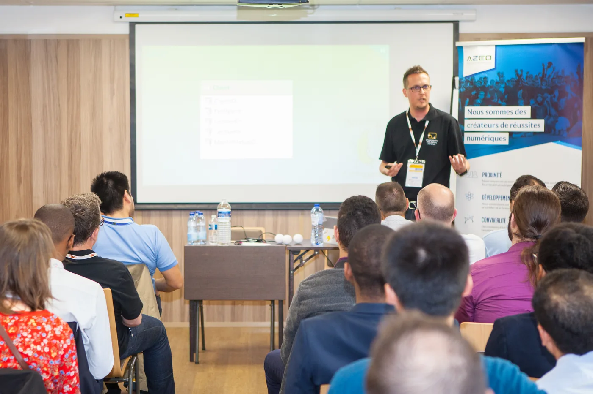

<section class="home-hero" aria-labelledby="about-name">

<h1 id="about-name">Arnaud Gastelblum</h1>

Data Architect, Microsoft Fabric &amp; Power BI

I work freelance. I design semantic models, build on Microsoft Fabric and Power BI, and use AI every day to deliver faster without cutting corners.

<a class="home-link home-link--strong" href="/contact/">Get in touch</a><a class="home-link" href="https://www.linkedin.com/in/arnaud-gastelblum/">LinkedIn</a>

</section>

## What I do

- **Data modelling first.** A clean star schema makes everything after it simple: the DAX, the reports, the performance. I've been [writing about it](/en/your-data-model-first/) for years.
- **Power BI and Microsoft Fabric.** Semantic models, DAX, Fabric warehouses and notebooks, and the tooling that keeps a tenant documented and under control.
- **SQL Server roots.** T-SQL, SSIS, SSMS: the ground I come from, and still use.

## How I work

- **Clean, readable code.** No redundancy, complexity kept at a level a colleague can follow, performance in mind, and the users always in mind.
- **AI as a teammate.** In my spare time I vibe code my own tools. I build with [Claude Code and Codex together](/ai/two-ai-developers), and I [let the AI test what it builds](/ai/ai-tests-real-app). It writes a lot of the code; the decisions stay mine.
- **Organised in Obsidian.** Notes, tasks and ideas live in one place, with tools I built for it: [Snailkit](/obsidian/snailkit).

## Sharing

I've always liked to share what I learn: on this blog, in short videos on [my YouTube channel](https://www.youtube.com/channel/UCOEtA2zMVmQg929AMFsIymg/videos), at the **Club Power BI Brussels** meetups, on stage at **Power Saturday** in Paris, and with **DataSprouts**, a group of Belgian Microsoft data consultants.

{: .about-photo }

Power Saturday, Paris, 2019: why the data model comes first in Power BI.
{: .about-caption }

I also give tools away: [dbt Formatter](/en/lazy-dbt-vs-code-extension/) for dbt models, [SSMS in VS Code](/sql-server/make-vs-code-look-and-feel-like-ssms), [Snailkit](/obsidian/snailkit) for Obsidian, a [code formatter](https://code.lazysnail.net) for DAX and SQL, and [LazyDAX](/en/lazydax-a-power-bi-file-for-your-presentation-discoveries-or-learn-dax/) to learn DAX. And the tools of others I rely on every day are on [Tools I use](/tools-i-use/).

## Why "LazySnail"?

{: .note }
> It started when I mentored a younger colleague. He was anything but lazy or slow, so I playfully called him *Lazy snail*. The name stayed, for the blog and everything around it.

## Outside work

Two kids, Pauline and Antoine, my greatest joys and challenges rolled into one. And running: several marathons and half marathons, for the moment I cross the finish line.
