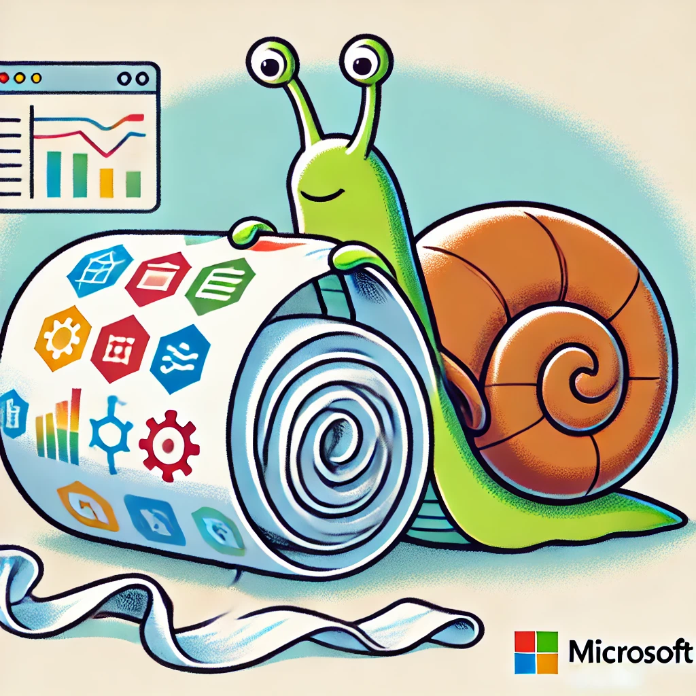

# Fabric

{: .note }
> Fabric now lives with Power BI: see [Power BI & Fabric](Power-BI). The Fabric articles are listed below too.

{:refdef: style="text-align: center;"}
  {: .image50}
{: refdef}

## All Articles
{: .section-title }

<ul class="article-list">
  
  
    
      <li class="article-item">
        <a href="{{ post.url }}">{{ post.title }}</a>
        {{ post.date | date: "%d %b %Y" }}
      </li>
    
  
</ul>
