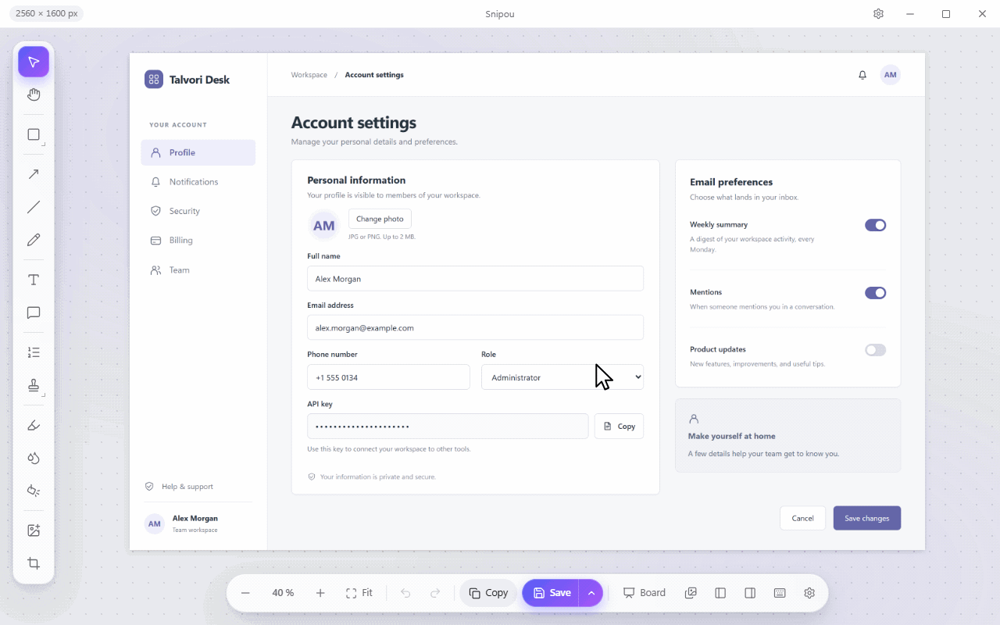
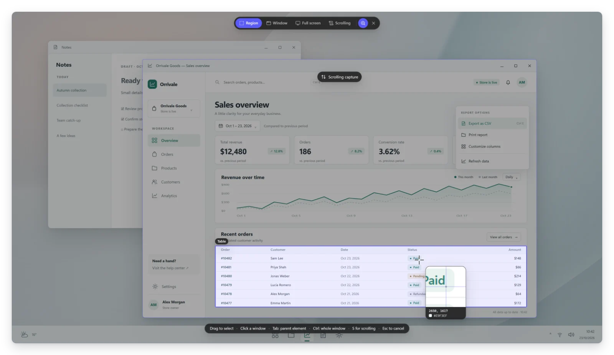
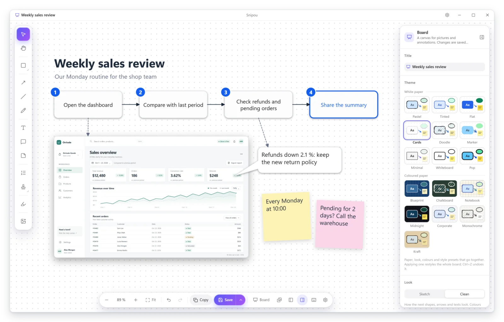
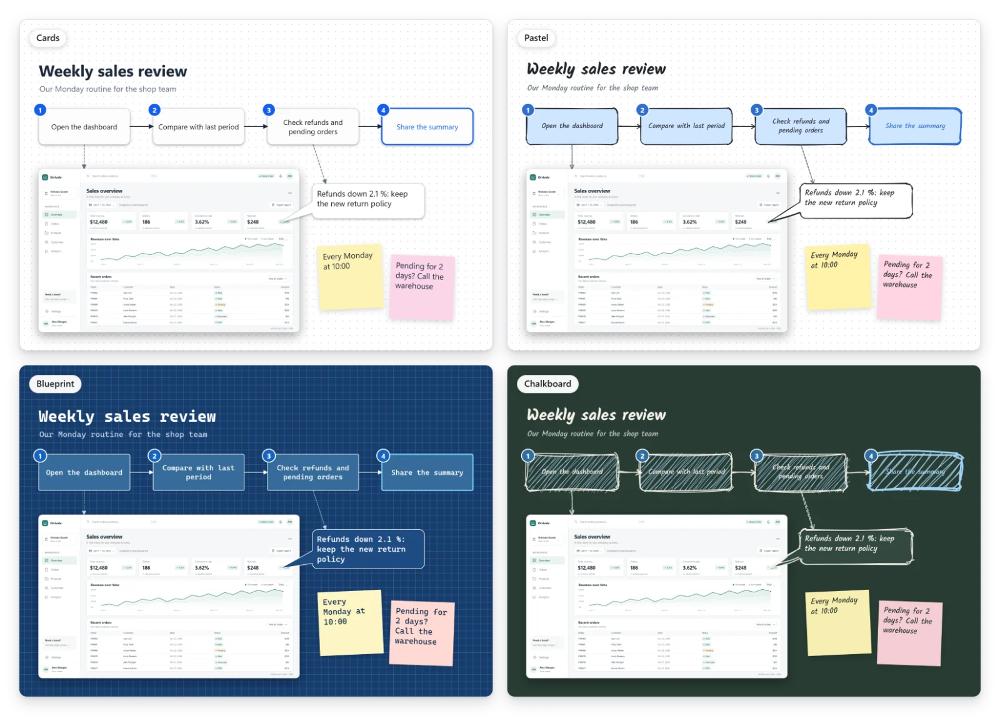
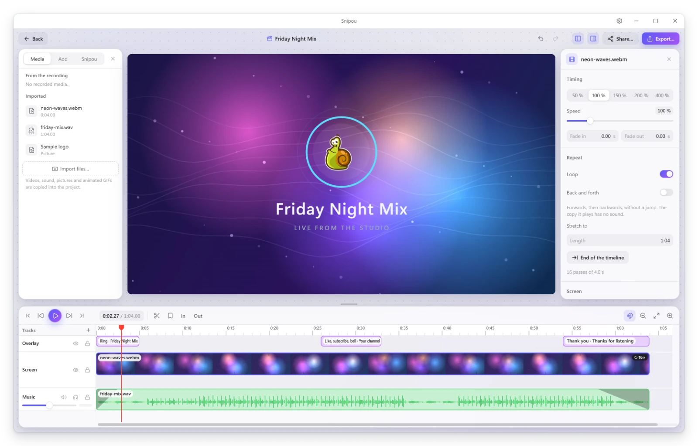
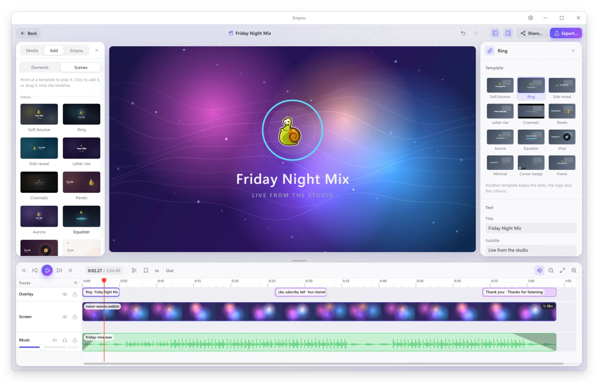

# {{ page.title }}
{: .fs-9 }

I share bits of my screen all the time: with colleagues, online, in tutorials, to show how something is done. I wanted one light, portable tool for the screenshot and for the whiteboard, used the same way. The ones I tried were heavy, old, rough or paid. Sometimes all four. So I built **Snipou**, and it's free.

I vibe coded it with [two AI developers](/ai/two-ai-developers): Claude Code plans and builds, Codex reviews.

{: .image80 }

## What it does

- **Capture precisely.** One hotkey freezes the screen. Hover a window, a menu or just the table inside it, and click. Or drag a region, with a magnifier for the last pixel.
- **Explain it.** Numbered steps, arrows, callouts, highlighter. Blur the email or the client name before you send it.
- **Paste it anywhere.** The capture is already in your clipboard, as a picture and as a file.
- **Tell the whole story on a board.** Put screenshots, shapes, arrows and sticky notes on one page. Sixteen themes, from clean cards to chalkboard.

{: .image80 }

{: .image80 }

{: .image80 }

## New: record it, then edit the video

Some things only make sense when they move. So Snipou now records too, and comes with a small video editor.

{: .image80 }

- **Record** a region, a window or the whole screen, with your voice, the system sound and your camera. Every click becomes a numbered step screenshot.
- **Edit** the video: cut, speed up the boring parts, zoom on what matters, add captions, music and transitions.
- **Open and close it properly** with animated intros, outros and "like and subscribe" prompts. Swap in your own text and logo, then save it as your template.
- **Turn five seconds into an hour.** Loop a short animation under a long music mix, or play it back and forth so it never jumps. Export an MP4, ready to upload.

{: .image80 }

## Try it

[{: .store-badge }](https://apps.microsoft.com/detail/9MZSSPHWZ8BL)

Get Snipou from the **[Microsoft Store](https://apps.microsoft.com/detail/9MZSSPHWZ8BL)**: one click, and Windows keeps it up to date. Windows 10 and 11. Then press `Ctrl+Shift+C`.

Prefer no Store? Take the **[installer](https://github.com/arnaudgastelblum/snipou-releases/releases/latest/download/snipou-setup.exe)** (no admin rights needed) or the **[portable version](https://github.com/arnaudgastelblum/snipou-releases/releases/latest/download/snipou-portable.zip)** (unzip and run). These aren't code-signed yet: if Windows says it protected your PC, click **More info**, then **Run anyway**.

No account, no telemetry, nothing sent anywhere: the [privacy policy](/tools/snipou/privacy) says it all. Every version is on [GitHub](https://github.com/arnaudgastelblum/snipou-releases/releases).

It covers what I need today. Next on my list: zooming and drawing live on the screen during a presentation. If Snipou helps you too, that's why it's free. [Tell me](https://www.linkedin.com/in/arnaud-gastelblum/) what's missing.
