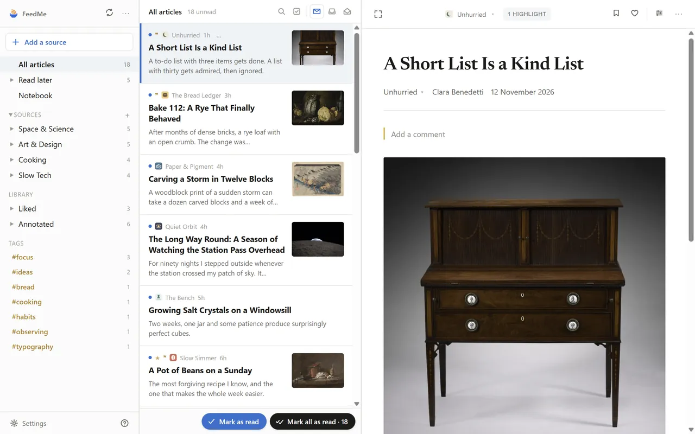
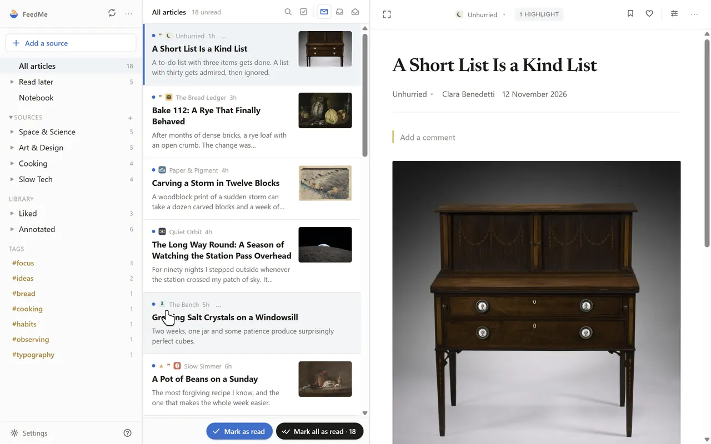
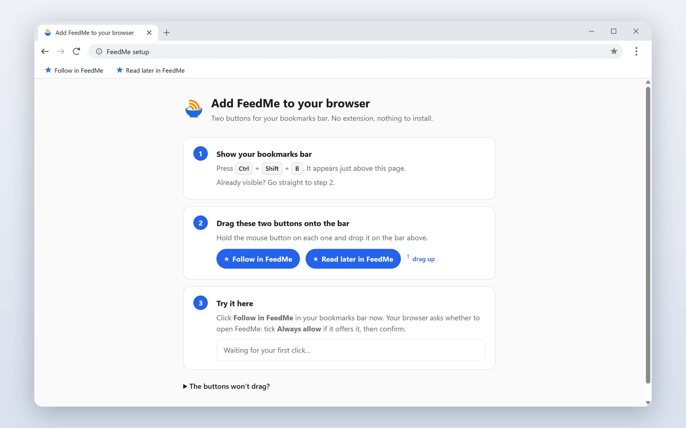
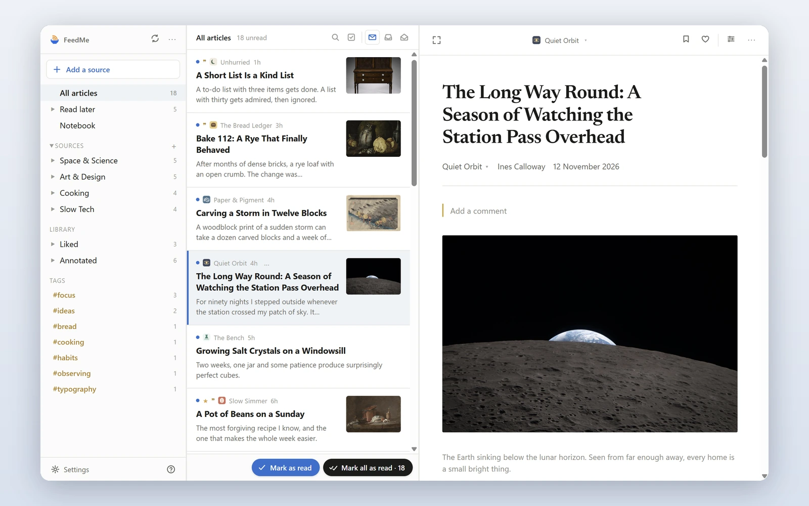
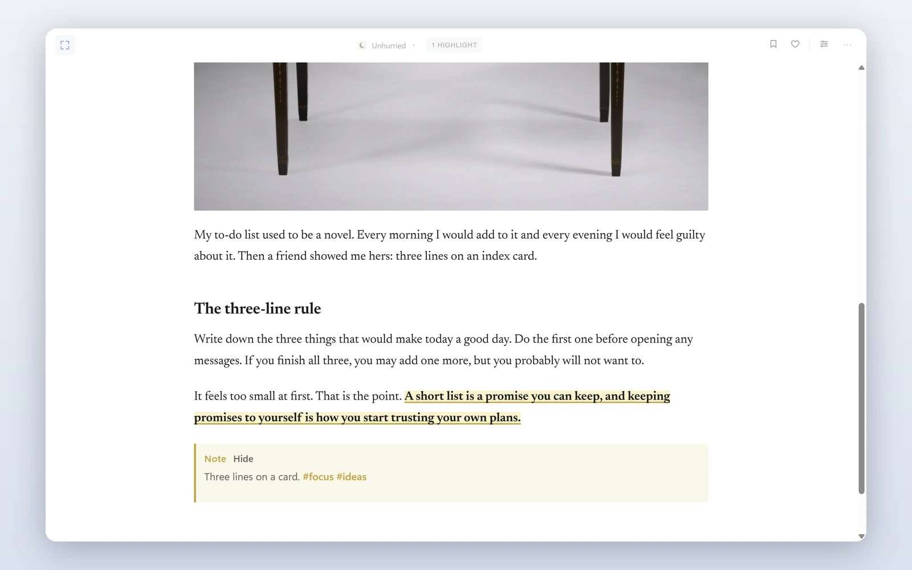
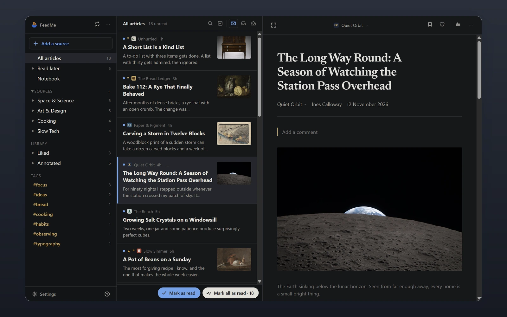
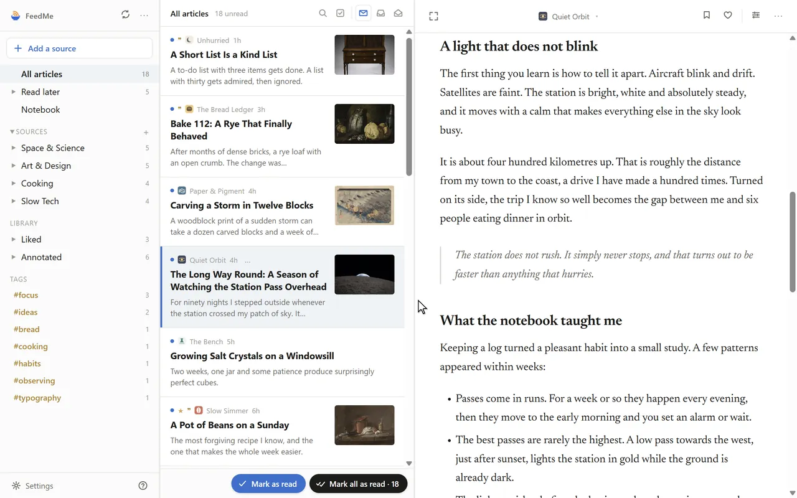
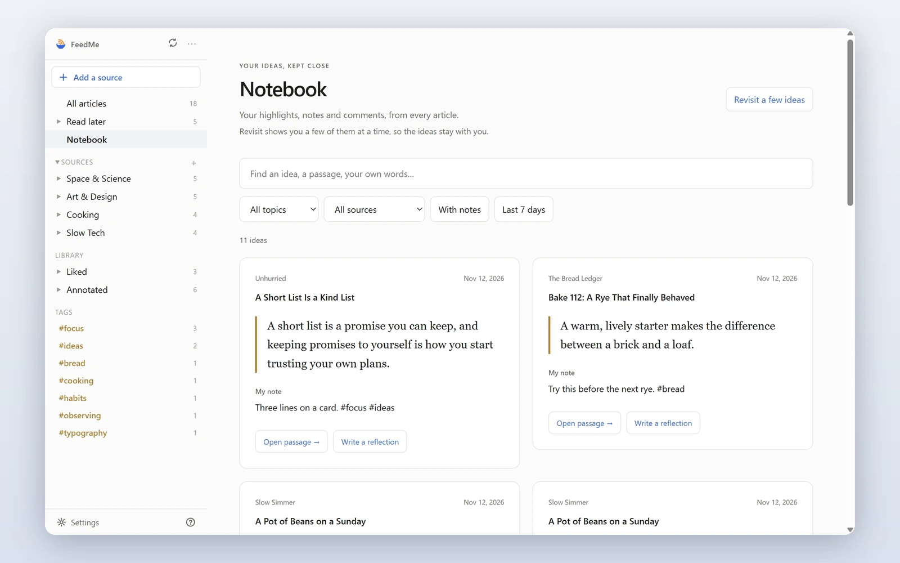
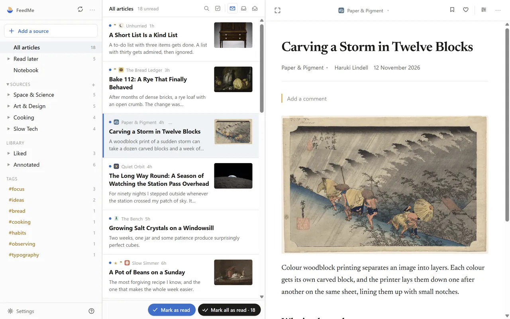
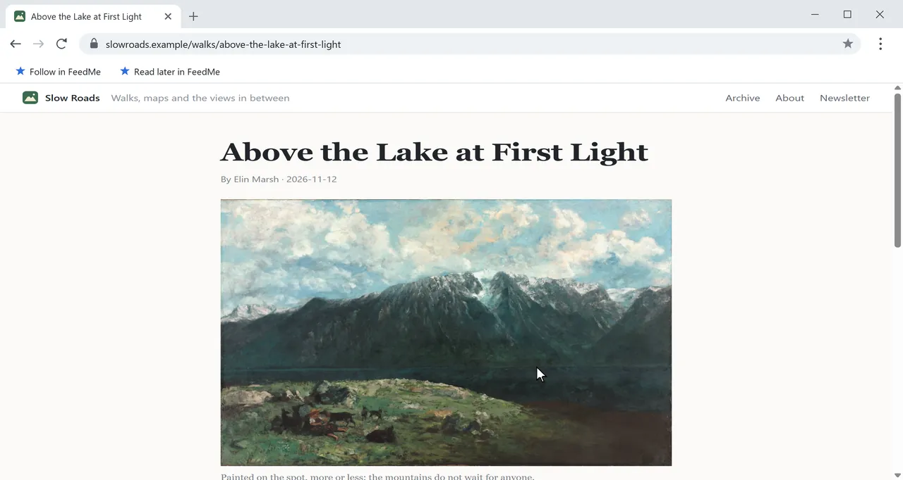

# {{ page.title }}
{: .fs-9 }

My reading was spread over three places: a feed reader in a browser tab, a read-later app, and highlights I never found again. I wanted one quiet place for all of it, on my own PC. So I built **FeedMe**, and it's free.

{: .image80 width="1280" height="800" }

No account, no ads, no tracking. Your library is a file on your computer. Here is how it works, in six steps.

[Download for Windows](#try-it){: .btn-primary-custom }

## 1. Add a source

Click **Add a source** and paste an address: a website, a blog, a YouTube channel or a subreddit. No need to hunt for the RSS link: FeedMe finds the feed and shows you its latest articles. If it looks right, press **Follow**.

{: .image80 width="1280" height="800" loading="lazy" }

Coming from another reader? Import its OPML file and your sources are all there.

## 2. Or follow from your browser

You are on a site you like, in Edge, Chrome or Firefox. Click **Follow in FeedMe** and FeedMe opens with that site, ready to follow. A second button, **Read later in FeedMe**, saves the page you are on.

They are two bookmarks, not an extension. FeedMe opens a page where you drag them to your bookmarks bar. You do it once.

{: .image80 width="1600" height="1000" loading="lazy" }

## 3. New articles come to you

FeedMe checks your sources when it starts, then every 30 minutes. Prefer 15 minutes, one hour, three hours, or only when you ask? It's in Settings.

Each source shows its number of unread articles. You stop visiting ten sites to see what's new. You open FeedMe.

{: .image80 width="1600" height="1000" loading="lazy" }

## 4. Read without the noise

No ads, no pop-ups, no "subscribe" banner. Just the article, with three fonts and the size and width you like. Press `f` for focus mode and everything else disappears. The feed only gives a summary? Press `c` and FeedMe loads the full article.

{: .image80 width="1600" height="1000" loading="lazy" }

Light or dark, as you like.

{: .image80 width="1600" height="1000" loading="lazy" }

## 5. Highlight, take notes, find them again

Select a sentence to highlight it, or to attach a note. A #hashtag in the note becomes a topic.

{: .image80 width="1280" height="800" loading="lazy" }

No more highlights I never find again. The **Notebook** gathers every highlight and note. Search it, or filter by topic, source or date.

{: .image80 width="1600" height="1000" loading="lazy" }

## 6. Read it later

A long article and no time now? Press `s`. A link from somewhere else? Paste it. FeedMe keeps an offline copy, images included, for when you have the time.

{: .image80 width="1280" height="800" loading="lazy" }

Still in your browser? That's the **Read later in FeedMe** button from step 2.

{: .image80 width="1280" height="682" loading="lazy" }

## A few more things

- **Keyboard first.** `j` and `k` to move, `m` to mark as read, `s` to save, `f` to focus. `?` shows the rest.
- **Take it with you.** Export your library as an EPUB for your e-reader, or send an article to Instapaper, which I [wrote about in 2020](/en/how-i-optimized-my-learning-time-with-instapaper/).
- **Yours to keep.** One file backs up and restores everything. Your sources export as OPML.

## Try it


  When the Store listing is live, replace STORE_URL (twice) and remove this comment block.

[{: .store-badge }](STORE_URL)

Get FeedMe from the **[Microsoft Store](STORE_URL)**: one click, and Windows keeps it up to date. Windows 10 and 11.

Prefer no Store?

[Download the installer](https://github.com/arnaudgastelblum/feedme-releases/releases/latest/download/FeedMe-setup.exe){: .btn-primary-custom } [Or the standalone zip](https://github.com/arnaudgastelblum/feedme-releases/releases/latest/download/FeedMe-portable.zip){: .btn-secondary-custom }

For Windows 10 and 11. The installer needs no admin rights. The zip is unzip and run, and your library stays in its folder. They aren't code-signed yet: if Windows says it protected your PC, click **More info**, then **Run anyway**.

Then add your first source. If you get lost, press `?` for the shortcuts or open **How FeedMe works** in the menu. The [privacy policy](/tools/feedme/privacy) says what is stored and where: on your PC.

I vibe coded it with Claude Code. It covers what I read every day. If it helps you too, that's why it's free. [Tell me](https://www.linkedin.com/in/arnaud-gastelblum/) what's missing.
