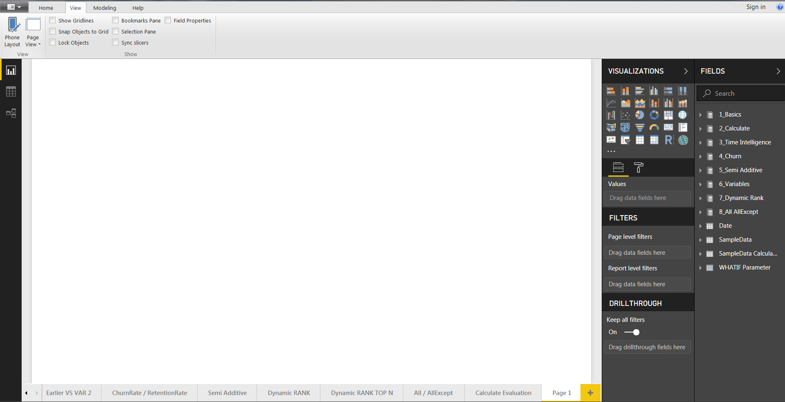
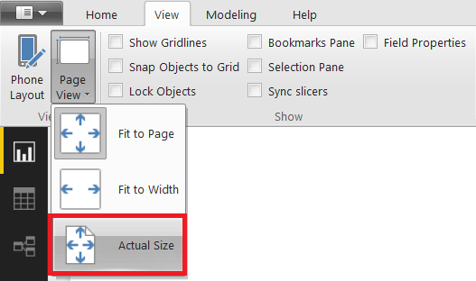
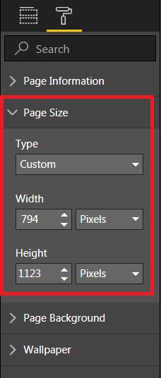
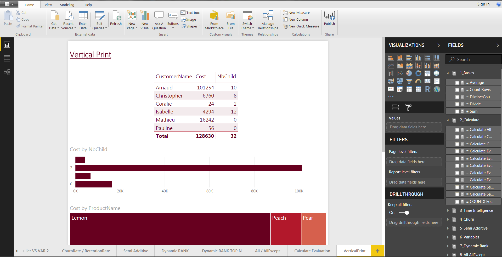
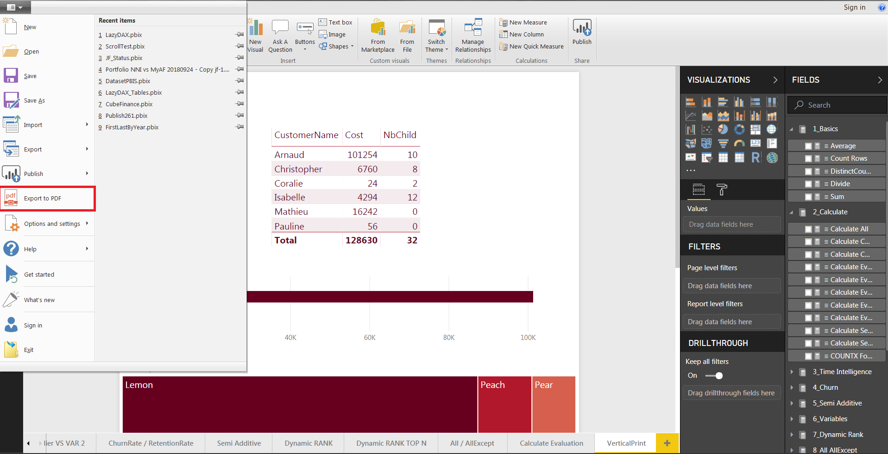
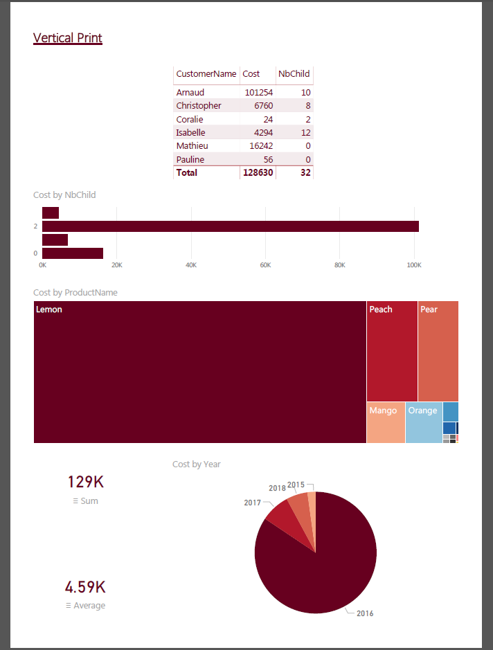

# {{ page.title }}
{: .fs-9 }

{:toc}

{: .note :}
>Learn how to export your Power BI Desktop reports in A4 portrait format by customizing the page size and exporting to PDF.

As you know, the **August 2018 update of Power BI Desktop** grants us the possibility to **export in PDF** directly from the Desktop. Two clicks and it's done. Great news right? I remember all the steps I had to go through to make it before, it still give me headache...

But by default, the report will be exported with the standard format of Power BI Desktop which can be for some end users or clients not very pleasant to read especially if they are used to an **A4 page**. The real question is then, how to export in that specific format? Here is the answer.

## Setting up the page

First, let's take our wonderful LazyDAX file and create a new page. Here is the default view you have when adding a new page.

Nothing special until there. What's interesting is the "Page View" button under the "View" tab. Once we click on it, we can select "Actual Size".

By choosing "Actual Size" we will see the "real" size of the page, based on its dimensions.

## Custom page size

Now we can see that the page size exceed the usual limit of the report. But we want to make it like a A4 portrait page right? So, we are not done yet. You can select the "Format" pane of the report page, then "Page Size" and select "Custom" as "Type". Now, we just have to enter the custom size we want. I chose 794*1123 pixels because it is the A4 size at 96 PPI (depending of the printing, you can find more info about it on [papersizes.org: A sizes in pixels](https://www.papersizes.org/a-sizes-in-pixels.htm)).

Now we have our A4 report page ready to be filled.

## Exporting to PDF

As you can see, there is now a scroll bar on the right side of the report because of the dimension of the page. We now just have to export as PDF and that's it. You can click on the "File" button and then choose "Export to PDF".

You now just have to let Power BI make the work and here is the result.

The last report page is well in portrait format, while the others have been exported in the default format.

As you can see, there is nothing really difficult here but you just have to be aware of it.
